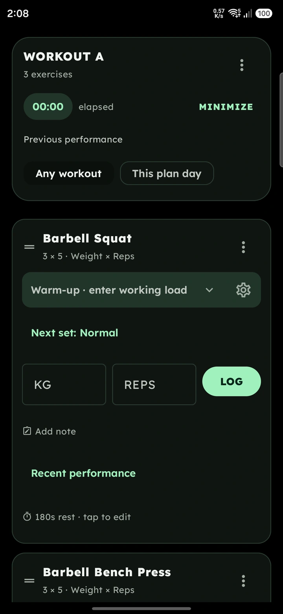
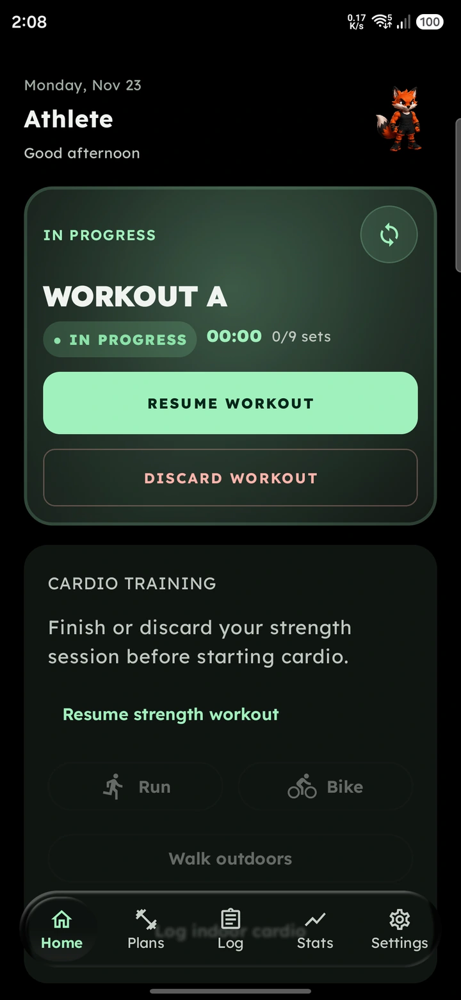
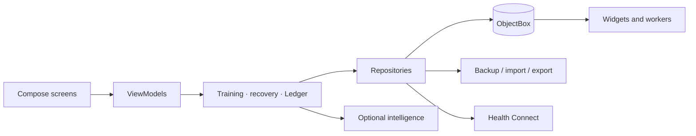

<div align="center">


[](https://github.com/Yannam-Builds/Ironlog/actions/workflows/android.yml)
[](https://github.com/Yannam-Builds/Ironlog/actions/workflows/web-pages.yml)


[](LICENSE)

**One local-first training log for the weight room, the road, and everything you learn between sessions.**

[Open the web app](https://yannam-builds.github.io/Ironlog/app/) · [Download Android preview](https://github.com/Yannam-Builds/Ironlog/releases/tag/v0.1.0-pre-alpha.11) · [See the native screens](#inside-the-android-app) · [Build locally](#build-and-verify)

</div>

> [!NOTE]
> IronLog is in active pre-alpha development. The signed [`0.1.0-pre-alpha.11` Android preview APK](https://github.com/Yannam-Builds/Ironlog/releases/tag/v0.1.0-pre-alpha.11) is available; there is no Play Store listing yet.

## The training loop


Log load, reps and effort during a session. Use the session and a recovery check-in to understand the next decision. Credit completed work to the Iron Ledger, then adjust the plan. The motion in these diagrams follows that flow and stops when reduced motion is requested.

## Use IronLog

| Android app | Web app |
| --- | --- |
| Jetpack Compose app with ObjectBox storage, Health Connect, foreground workout tracking, widgets, and optional on-device or user-configured cloud intelligence. | Installable browser app with local workout storage, a full-screen mobile layout, and a live app preview inside the website. |
| Plans, workout logging, history, recovery, body tracking, Ledger, and explicit backup/restore. | Home, Plans, Log, Stats, Settings, recovery, measurements, photo comparison, Ledger, and validated backup/restore. |

The web app shares IronLog's visual system and core training flow. It is still a preview: Android-only integrations and some native behavior do not have browser equivalents. The [web acceptance record](web/docs/acceptance.md) and [parity notes](web/docs/domain-parity.md) describe what is tested and what remains different.

Both versions keep their primary record on the device or browser where it was created. There is no automatic account sync. Export and restore are explicit actions; keep a backup before clearing browser data or changing devices.

## Inside the Android app

These screenshots come from a newer native preview using the demo profile **Athlete** and a starter barbell plan. The downloadable APK above is an earlier release.

| Today's workout | Plan and training days | Active workout |
| :---: | :---: | :---: |
| <a href=".github/assets/screens/preview-home-shift-green.webp"></a> | <a href=".github/assets/screens/preview-plans-shift-green.webp"></a> | <a href=".github/assets/screens/preview-workout-onyx-green.webp"></a> |
| Start the recommended day from Home. | Choose a plan and switch between its days. | See previous sets and warm-ups beside the logger. |

| Onyx Green | Midnight Blue | Theme previews |
| :---: | :---: | :---: |
| <a href=".github/assets/screens/preview-resume-onyx-green.webp"></a> | <a href=".github/assets/screens/preview-resume-midnight-blue.webp"></a> | <a href=".github/assets/screens/preview-appearance-midnight-blue.webp"></a> |
| Pure black with mint controls. | Near-black navy with icy blue controls. | Compare and switch themes in Settings. |

### From the first set to the finish line

The newer Android preview shown here adds outdoor training and route replay. The downloadable APK above is an earlier preview. Web support varies by feature.

| Feature | What you can do in the Android preview |
| --- | --- |
| **Strength logging** | Record load, reps, effort, set type and notes. Compare previous sets across workouts or within the same plan day. Configure exercise and set-type rest timers, calculate warm-ups for the plates you have, and resume a minimized workout. |
| **Plans and progression** | Pick, build, import, or share a program. Organize days and exercises, keep rep ranges through logging, track personal records, and review why a progression was suggested. |
| **Outdoor cardio** | Record Run, Bike, and Walk with a live GPS map, distance, pace or speed, pause and resume, and a visible screen-off recording service. Review the saved route and splits. |
| **Route replay and sharing** | Scrub recorded time in 2D or use the 3D camera where terrain is available. Review metrics along the route, export GPX, and create a share card with control over whether the route and its endpoints appear. |
| **Recovery and progress** | Review estimated muscle recovery, workout history, volume, body measurements and photos. See separate weekly strength, running, and cycling totals. Connect supported Health Connect signals if you choose. |
| **Motivation and personalization** | Earn Ledger progress, badges and personal records from logged training. Choose colors, typography, layout spacing, and optional motion. Use widgets, reminders, and rest notifications. |
| **Data ownership** | Train with a local history. Keep explicit backups, preview restores, and delete or export activities. Optional cloud intelligence uses the provider you configure. |

## How it is built



The Android app uses Kotlin, Jetpack Compose, ObjectBox, WorkManager, Health Connect, CameraX/ML Kit and Jetpack Glance. The separate [web project](web/README.md) uses React, TypeScript and IndexedDB.

## Build and verify

IronLog's first-party Android and web source code is available under the [Apache License, Version 2.0](LICENSE).

Android requires JDK 17 and Android SDK 36. From the repository root:

```sh
./gradlew testDebugUnitTest lintDebug assembleDebug
```

Use `gradlew.bat` on Windows. Release signing stays local; do not commit `local.properties` or a keystore. See [Contributing](CONTRIBUTING.md) and [Security](SECURITY.md).

The web project requires Node 24:

```sh
cd web
npm ci
npm test
npm run build
npm run verify:output
```

GitHub Actions also runs browser acceptance in Chromium and WebKit, including a cached workout with the HTTP origin stopped. See the [Android workflow](https://github.com/Yannam-Builds/Ironlog/actions/workflows/android.yml) and [web workflow](https://github.com/Yannam-Builds/Ironlog/actions/workflows/web-pages.yml) for the current result. Automated coverage does not replace physical-device and accessibility review.

## Project status

Before a store release, IronLog still needs broader Android API/OEM regression coverage, Play data-safety and Health Connect declarations, final privacy and foreground-service review, signing-key/history remediation, and a release version decision. The [native app audit](docs/reviews/2026-08-31-ironlog-app-audit.md) and [notification/settings audit](docs/reviews/2026-09-01-notification-feature-harmony-settings-audit.md) record known issues and their evidence.

The Apache license covers first-party source code in this release. The IronLog name, logo, and original visual artwork remain reserved. Third-party software, fonts, data and artwork retain their own terms. See [Third-party notices](THIRD_PARTY_NOTICES.md) before redistributing bundled assets. Earlier releases retain the terms they shipped with.

<div align="center"><strong>Train. Recover. Prove it.</strong></div>
