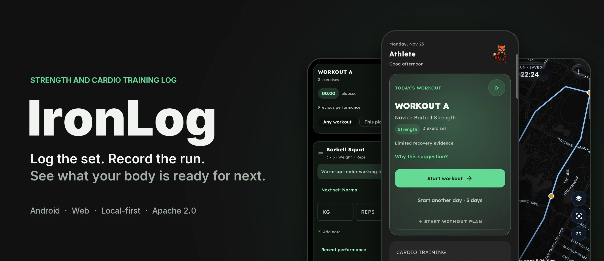
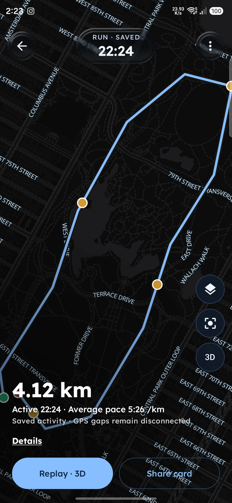
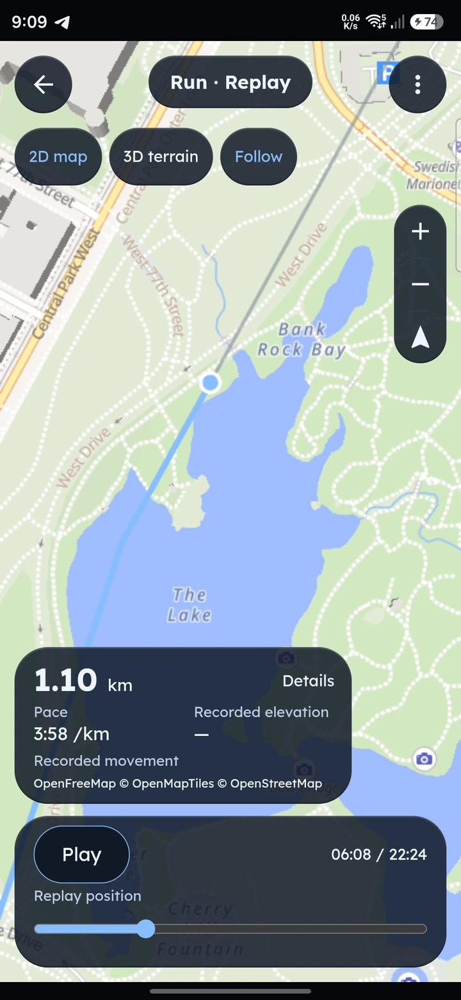
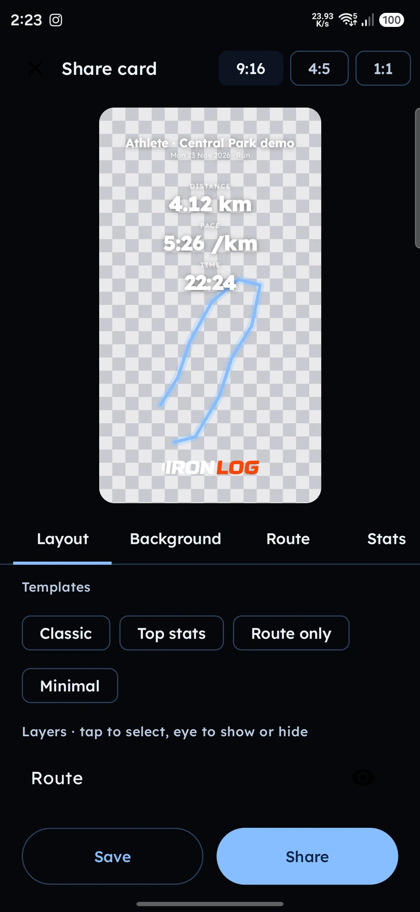
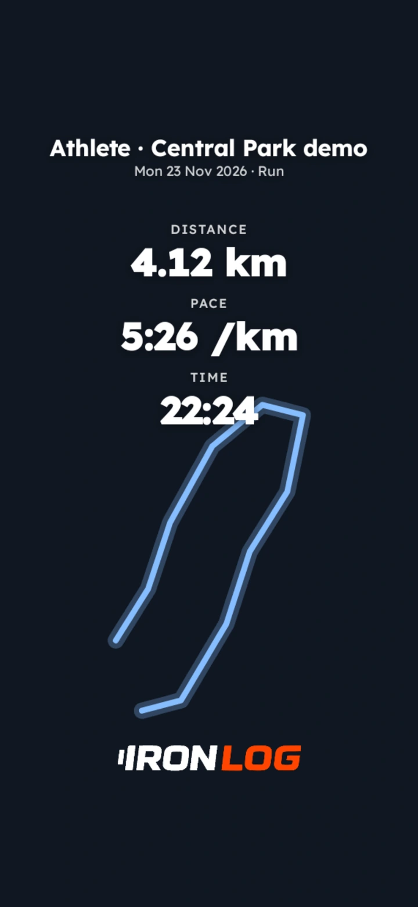
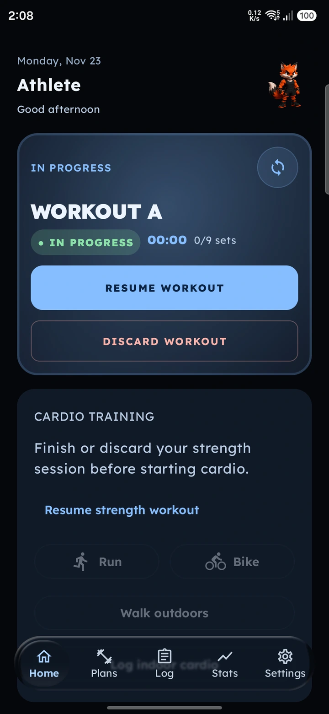

<div align="center">



[](https://github.com/Yannam-Builds/Ironlog/actions/workflows/android.yml)
[](https://github.com/Yannam-Builds/Ironlog/actions/workflows/web-pages.yml)
[](LICENSE)

[Web app](https://yannam-builds.github.io/Ironlog/app/) · [Android preview](https://github.com/Yannam-Builds/Ironlog/releases/tag/v0.1.0-pre-alpha.11) · [Screenshots](#screenshots) · [Features](#features) · [Build](#build)

</div>

IronLog is a training log for people who lift and also run or ride. Sets, runs and rides go into one history on your phone, recovery is estimated from that history, and the Iron Ledger keeps score of the work you have actually done. There is no account and no cloud sync; your data stays on the device unless you export it.

> [!NOTE]
> IronLog is in pre-alpha. The signed [`0.1.0-pre-alpha.11` APK](https://github.com/Yannam-Builds/Ironlog/releases/tag/v0.1.0-pre-alpha.11) is the public build and there is no Play Store listing yet. The screenshots and the cardio features below come from newer preview builds that are not released.

## Screenshots

The screens use a demo profile called Athlete with a starter barbell plan.

| Home | Plans | Logging a workout |
| :---: | :---: | :---: |
|  |  |  |
| Today's workout is picked from your plan and recovery. | Switch programs or start any day. | Previous sets and warm-ups sit next to the logger. |

| Saved run | 2D replay | 3D replay |
| :---: | :---: | :---: |
|  |  |  |
| Route, splits, pace and time. | Scrub to any moment of the run. | Follow it again on terrain. |

| Share Studio | Exported card | Photo card |
| :---: | :---: | :---: |
|  | <a href=".github/assets/screens/preview-cardio-share.png"></a> |  |
| Choose what the card shows. | Transparent PNG, endpoints hidden. | Put a photo behind the route. |

| Onyx Green | Midnight Blue | Theme picker |
| :---: | :---: | :---: |
|  |  |  |
| Minimize a workout and pick it up later. | One of fifteen themes. | Preview themes before you switch. |

The run is simulated, recorded in the Android QA build on a Galaxy S25 Ultra. The portrait on the photo card is AI-generated. Maps by [OpenFreeMap](https://openfreemap.org/) and [OpenMapTiles](https://openmaptiles.org/), data [© OpenStreetMap contributors](https://www.openstreetmap.org/copyright), terrain credited by [Mapterhorn](https://mapterhorn.com/attribution/).

## Features

These describe the native Android app. The web app covers the core strength flow; see [what differs](web/docs/domain-parity.md).

### Lifting

- Log load, reps, set type (warm-up, drop, AMRAP, to failure), RPE or RIR, and notes.
- See what you lifted last time, either in any workout or only on the same plan day.
- Warm-ups are calculated from the bar and plates in your gym profile.
- Rest timers per exercise and set type. Pause, add 30 seconds or skip from the notification.
- Supersets, exercise swaps and one-off target changes without editing the plan.
- Minimize a workout and come back to it; a foreground notification keeps it running.
- Fix or back-fill finished workouts, including the date and duration.

### Plans

- Start from the program library, build your own, or generate one with the AI plan creator.
- Share a plan as a QR code and import one by scanning.
- Rep ranges carry into logging, and progression suggestions say why they want more weight.
- Personal records with estimated one-rep maxes, plus a progress chart per exercise.

### Running, riding, walking

- Live GPS map with distance, pace or speed, elevation and auto-pause. Recording continues with the screen off.
- Light, dark, terrain and satellite maps, with optional 3D tilt.
- Spoken split and pause announcements.
- Treadmill, stationary bike, rower and StairMaster sessions without GPS.
- Kilometre or mile splits, 2D and 3D replay, and GPX export.
- Share Studio for route cards, with endpoint hiding so your start and finish stay private.

### Recovery and body

- A front and back muscle map estimates what has recovered since your last sessions.
- Optional Health Connect: sleep, resting heart rate and HRV feed into readiness.
- Body weight, measurements, and progress photos compared side by side by date.

### Stats

- Weekly totals kept separate for strength, running, cycling, walking and indoor work.
- Volume by muscle group and week, the last fourteen days at a glance, streaks and averages.

### The Iron Ledger

Qualifying sessions earn grades from Graphite up to Apex, along with badges and streaks. Short or empty sessions do not count, which keeps the grade honest.

### Your setup

- Fifteen colour themes, a choice of typefaces, adjustable spacing, kg or lb.
- An optional card shine that follows the tilt of your phone. Battery mode turns decoration off.
- Home-screen widgets, workout reminders with quiet hours, and rest alerts.

### Your data

- Stored on the device. No account, no sync.
- Encrypted snapshots, scheduled local backups, and a preview before anything is restored.
- Import from IronLog, Strong, Hevy and OpenWeight; export JSON or CSV.

## Build

Android needs JDK 17 and Android SDK 36:

```sh
./gradlew testDebugUnitTest lintDebug assembleDebug
```

Use `gradlew.bat` on Windows. Release signing stays local, so never commit `local.properties` or a keystore.

The web app needs Node 24:

```sh
cd web
npm ci
npm test
npm run build
npm run verify:output
```

The Android app is Kotlin with Jetpack Compose, ObjectBox, WorkManager, Health Connect, CameraX with ML Kit and Jetpack Glance; the newer previews add MapLibre for maps. The [web app](web/README.md) is React, TypeScript and IndexedDB. CI runs the Android tests and browser acceptance in Chromium and WebKit; see [Contributing](CONTRIBUTING.md) and [Security](SECURITY.md).

## Status and license

Before a store release IronLog still needs wider device testing, Play data-safety and Health Connect declarations, a final privacy and foreground-service review, and signing-key remediation. Known issues are tracked in the [app audit](docs/reviews/2026-08-31-ironlog-app-audit.md) and the [notification and settings audit](docs/reviews/2026-09-01-notification-feature-harmony-settings-audit.md).

First-party source is licensed under [Apache 2.0](LICENSE). The IronLog name, logo and original artwork are reserved. Third-party software, fonts, data and artwork keep their own terms; see [Third-party notices](THIRD_PARTY_NOTICES.md). Earlier releases keep the terms they shipped with.
