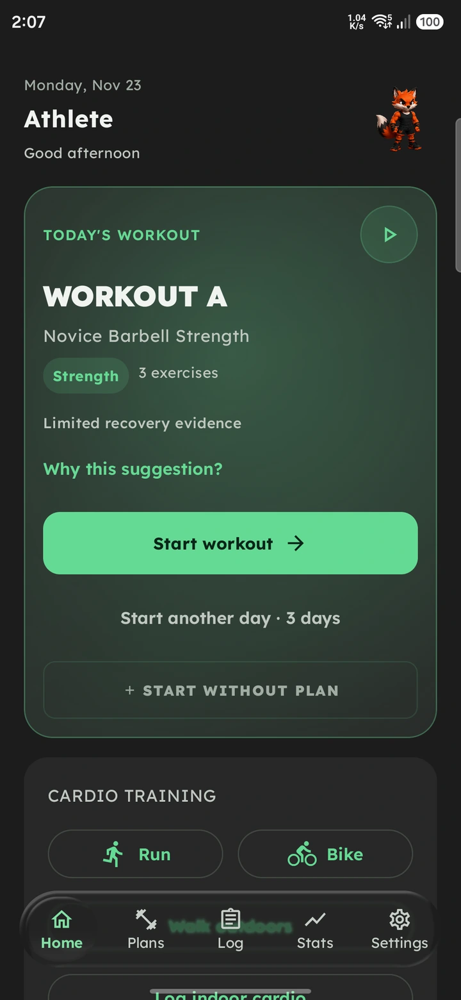
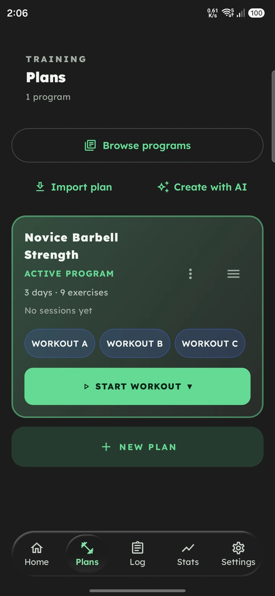
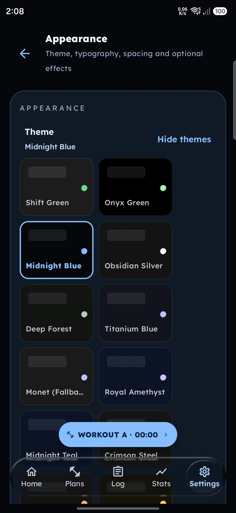
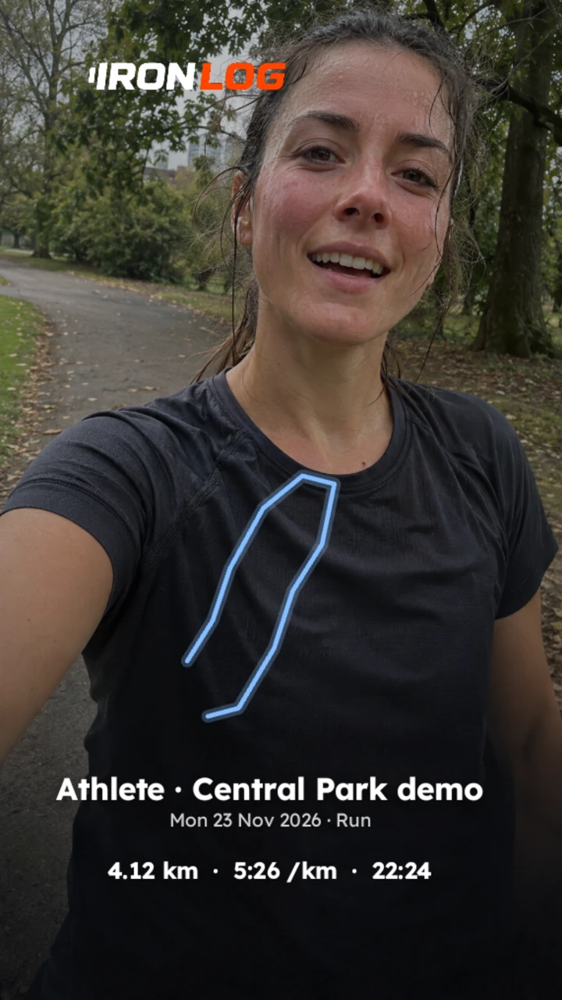
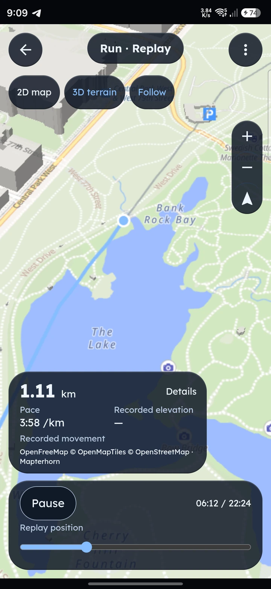
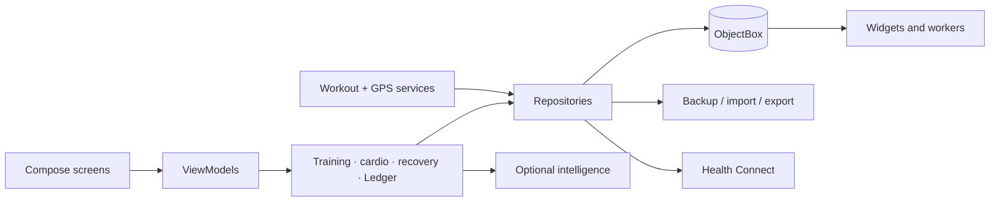

<div align="center">


[](https://github.com/Yannam-Builds/Ironlog/actions/workflows/android.yml)
[](https://github.com/Yannam-Builds/Ironlog/actions/workflows/web-pages.yml)


[](LICENSE)

**One local-first training log for the weight room, the road, and everything you learn between sessions.**

[Open the web app](https://yannam-builds.github.io/Ironlog/app/) · [Download Android preview](https://github.com/Yannam-Builds/Ironlog/releases/tag/v0.1.0-pre-alpha.11) · [See the native screens](#inside-the-android-app) · [All features](#everything-in-ironlog) · [Build locally](#build-and-verify)

</div>

> [!NOTE]
> IronLog is in active pre-alpha development. The signed [`0.1.0-pre-alpha.11` Android preview APK](https://github.com/Yannam-Builds/Ironlog/releases/tag/v0.1.0-pre-alpha.11) is available; there is no Play Store listing yet. Several features below come from newer native previews and are not in that APK.

## The training loop


Pick a program, log your sets, record your runs and rides, read your recovery, and earn your progress in the Iron Ledger. Strength and cardio live in one history, so every session informs the next. The motion in these diagrams stops when reduced motion is requested.

## Use IronLog

| Android app | Web app |
| --- | --- |
| Jetpack Compose app with ObjectBox storage, Health Connect, foreground workout and GPS tracking, widgets, and optional on-device or user-configured cloud intelligence. | Installable browser app with local workout storage, a full-screen mobile layout, and a live app preview inside the website. |
| Plans, strength logging, outdoor and indoor cardio, history, recovery, body tracking, Ledger, and explicit backup/restore. | Home, Plans, Log, Stats, Settings, recovery, measurements, photo comparison, Ledger, and validated backup/restore. |

The web app shares IronLog's visual system and core training flow. It is still a preview: Android-only integrations and some native behavior do not have browser equivalents. The [web acceptance record](web/docs/acceptance.md) and [parity notes](web/docs/domain-parity.md) describe what is tested and what remains different.

Both versions keep their primary record on the device or browser where it was created. There is no automatic account sync. Export and restore are explicit actions; keep a backup before clearing browser data or changing devices.

## Inside the Android app

These screenshots come from a newer native preview using the demo profile **Athlete** and a starter barbell plan. The downloadable APK above is an earlier release.

| Today's workout | Plan and training days | Active workout |
| :---: | :---: | :---: |
| <a href=".github/assets/screens/preview-home-shift-green.webp"></a> | <a href=".github/assets/screens/preview-plans-shift-green.webp"></a> | <a href=".github/assets/screens/preview-workout-onyx-green.webp"></a> |
| Start the recommended day from Home. | Choose a plan and switch between its days. | See previous sets and warm-ups beside the logger. |

| Onyx Green | Midnight Blue | Theme previews |
| :---: | :---: | :---: |
| <a href=".github/assets/screens/preview-resume-onyx-green.webp"></a> | <a href=".github/assets/screens/preview-resume-midnight-blue.webp"></a> | <a href=".github/assets/screens/preview-appearance-midnight-blue.webp"></a> |
| Pure black with mint controls. | Near-black navy with icy blue controls. | Compare and switch themes in Settings. |

### GPS routes and share cards

| Saved GPS route | Share Studio | Exported card |
| :---: | :---: | :---: |
| <a href=".github/assets/screens/preview-cardio-map.webp"></a> | <a href=".github/assets/screens/preview-cardio-studio.webp"></a> | <a href=".github/assets/screens/preview-cardio-share.png"></a> |
| Review the route and splits or start replay. | Change layout and control which route details appear. | Download the original transparent PNG. |

The activity is a **simulated Central Park run** created in the Android QA app on a Galaxy S25 Ultra. The exported card uses the app's endpoint hiding. The gallery displays the transparent PNG over a dark background. Basemap by [OpenFreeMap](https://openfreemap.org/) and [OpenMapTiles](https://openmaptiles.org/), with data from [© OpenStreetMap contributors](https://www.openstreetmap.org/copyright).

### Photo cards and route replay

| Post-run photo card | 2D replay | 3D terrain replay |
| :---: | :---: | :---: |
| <a href=".github/assets/screens/preview-cardio-photo.webp"></a> | <a href=".github/assets/screens/preview-replay-2d.webp"></a> | <a href=".github/assets/screens/preview-replay-3d.webp"></a> |
| Add a photo behind the clipped route and run stats. | Scrub to a recorded moment to see position and pace. | Follow the same timeline on a tilted terrain map. |

The portrait is AI-generated. The card was exported from Share Studio on the Galaxy S25 Ultra, and the replay images show the same simulated run with endpoints hidden. Basemap by [OpenFreeMap](https://openfreemap.org/) and [OpenMapTiles](https://openmaptiles.org/), with data from [© OpenStreetMap contributors](https://www.openstreetmap.org/copyright). Terrain sources are credited by [Mapterhorn](https://mapterhorn.com/attribution/).

## Everything in IronLog

The lists below describe the native Android app. Newer items ship in preview builds first; web support varies by feature.

### Strength training

- **Fast set logging:** load, reps, set type (normal, warm-up, drop, AMRAP, to failure), RPE or RIR, and notes per set.
- **Previous performance:** see your last sets for an exercise across all workouts or only within the same plan day.
- **Warm-up calculator** that works from the bar and plates in your current gym profile.
- **Rest timers** per exercise and per set type, with a countdown notification that you can pause, extend by 30 seconds or skip from the lock screen.
- **Supersets**, exercise swaps, extra exercises and per-session target overrides without changing the plan.
- **Minimize and resume** a workout from Home; a foreground notification keeps the session alive.
- **Edit or back-fill** completed workouts, including the date, duration, sets and notes.
- **Workout calendar** and a searchable, filterable history.

### Plans and progression

- Pick from a **program library**, build your own in the plan editor, or create one with the **AI plan creator**.
- **Share plans** and import them by **scanning a QR code**.
- Rep ranges carry through logging; a **progression engine** suggests when to add load and explains why.
- **Program insights** and **training intelligence** review adherence, volume and next-session targets, using the built-in engine or a cloud provider you configure.
- **Personal records** with an estimated one-rep max, and a per-exercise progress view.

### Cardio

- **Run, Bike and Walk** with a live GPS map, distance, pace or speed, elevation, auto-pause, and a visible foreground service that keeps recording with the screen off.
- **Map styles:** automatic, light, dark, terrain and satellite, with optional 3D tilt.
- **Voice coach** announcements for splits and status changes.
- **Indoor sessions** for treadmill, stationary bike, rower and StairMaster.
- **Saved routes** with kilometre or mile splits, **2D and 3D route replay**, and **GPX export**.
- **Share Studio:** design a transparent share card with your route, distance, pace and time, and hide the route's endpoints for privacy.

### Recovery and body

- **Muscle recovery map** (front and back) estimated from your logged training, plus a daily readiness check-in.
- **Health Connect** (optional): sleep, resting heart rate and heart-rate variability inform recovery.
- **Body weight** tracking, **body measurements**, and **progress photos** with side-by-side date comparison.

### Stats and analytics

- Weekly totals split by strength, running, cycling, walking and indoor training.
- **Volume analytics** by muscle group and week, with a shareable summary.
- Session, streak, set and duration summaries, the last-14-days activity chart, and exercise progress charts.

### Motivation: the Iron Ledger

- Logged work earns **Ledger grades** (Graphite, Iron, Steel, Titanium, Obsidian, Iridium, Aether and Apex), with credit only for qualifying sessions.
- **Badges and achievements**, a **daily proof** card, streaks and a weekly goal.
- The **Forge Fox** mascot reacts to your training state.

### Personalization

- **15 themes**, including Shift Green, Onyx Green, Midnight Blue, Royal Amethyst, Titanium Blue, AMOLED and Light.
- Typography presets and font choice, adjustable spacing, and kg or lb.
- Optional motion: an animated workout-card shine that follows how you tilt the phone, and a liquid-glass tab bar. Battery mode turns decorative rendering off.
- **Home-screen widgets:** dashboard, grade-and-streak badge, and War Room.
- **Reminders** with quiet hours, milestone notifications and rest alerts.

### Your data

- Everything is stored **locally** on your device; there is no account and no automatic cloud sync.
- **Encrypted snapshots** and scheduled automatic backups, with a preview before any restore.
- **Import** from IronLog backups, Strong CSV, Hevy CSV and OpenWeight JSON; **export** JSON or CSV.
- Exercise library management with custom exercises, and gym profiles for your bars and plates.
- Delete individual activities, or clear history, with a clear description of what is removed.

### In development

- A **workout island**: an optional pill shown over other apps during a workout, with the rest countdown and set progress.

## How it is built



The Android app uses Kotlin, Jetpack Compose, ObjectBox, WorkManager, Health Connect, CameraX/ML Kit and Jetpack Glance, plus MapLibre for GPS maps in the newer native previews. The separate [web project](web/README.md) uses React, TypeScript and IndexedDB.

## Build and verify

IronLog's first-party Android and web source code is available under the [Apache License, Version 2.0](LICENSE).

Android requires JDK 17 and Android SDK 36. From the repository root:

```sh
./gradlew testDebugUnitTest lintDebug assembleDebug
```

Use `gradlew.bat` on Windows. Release signing stays local; do not commit `local.properties` or a keystore. See [Contributing](CONTRIBUTING.md) and [Security](SECURITY.md).

The web project requires Node 24:

```sh
cd web
npm ci
npm test
npm run build
npm run verify:output
```

GitHub Actions also runs browser acceptance in Chromium and WebKit, including a cached workout with the HTTP origin stopped. See the [Android workflow](https://github.com/Yannam-Builds/Ironlog/actions/workflows/android.yml) and [web workflow](https://github.com/Yannam-Builds/Ironlog/actions/workflows/web-pages.yml) for the current result. Automated coverage does not replace physical-device and accessibility review.

## Project status

Before a store release, IronLog still needs broader Android API/OEM regression coverage, Play data-safety and Health Connect declarations, final privacy and foreground-service review, signing-key/history remediation, and a release version decision. The [native app audit](docs/reviews/2026-08-31-ironlog-app-audit.md) and [notification/settings audit](docs/reviews/2026-09-01-notification-feature-harmony-settings-audit.md) record known issues and their evidence.

The Apache license covers first-party source code in this release. The IronLog name, logo, and original visual artwork remain reserved. Third-party software, fonts, data and artwork retain their own terms. See [Third-party notices](THIRD_PARTY_NOTICES.md) before redistributing bundled assets. Earlier releases retain the terms they shipped with.

<div align="center"><strong>Train. Recover. Prove it.</strong></div>
